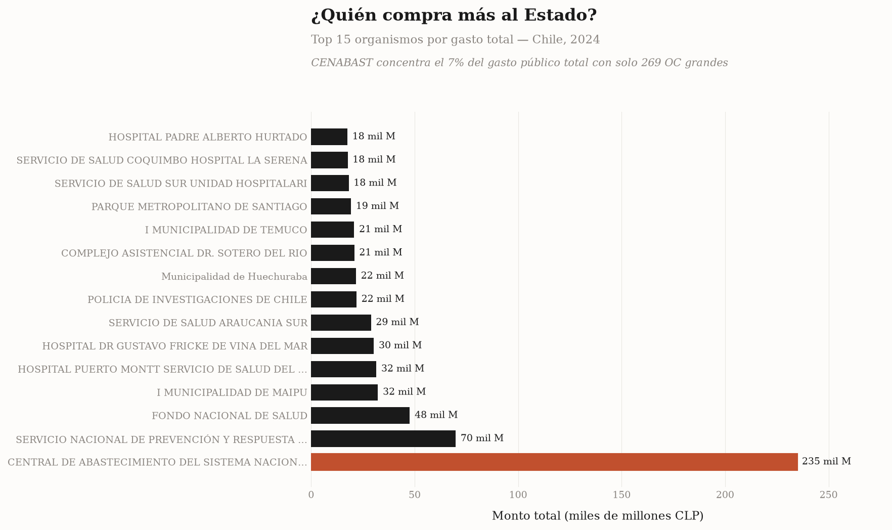
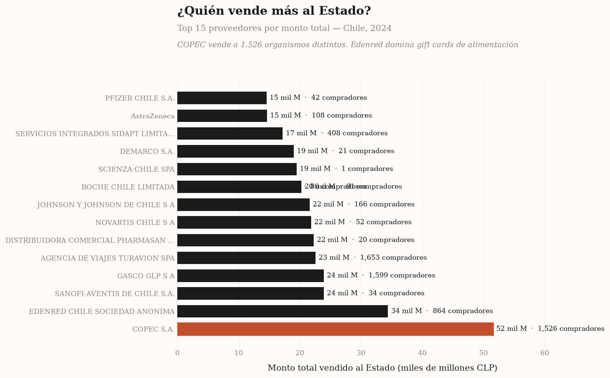
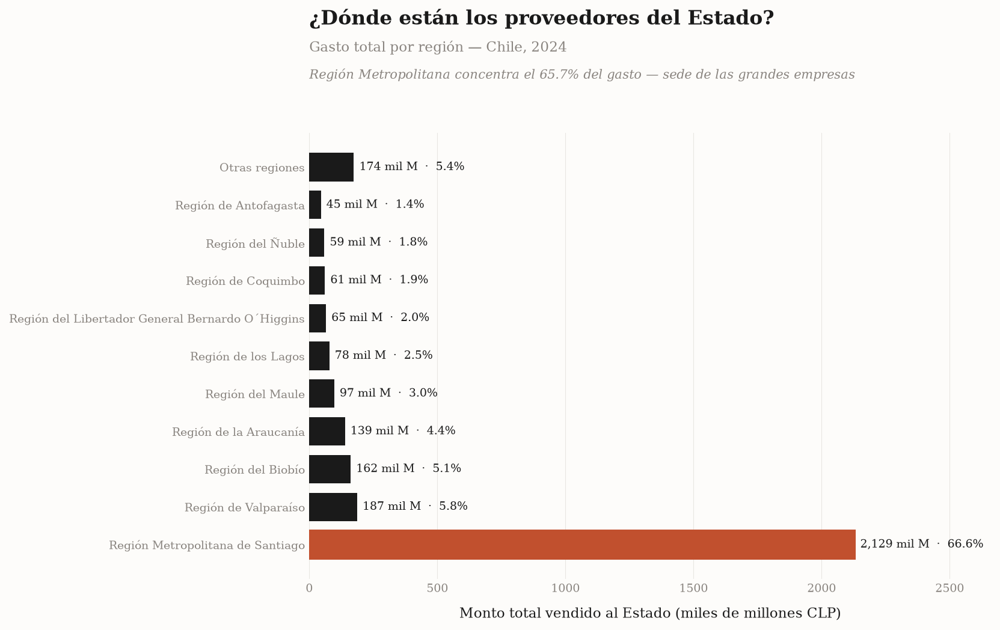
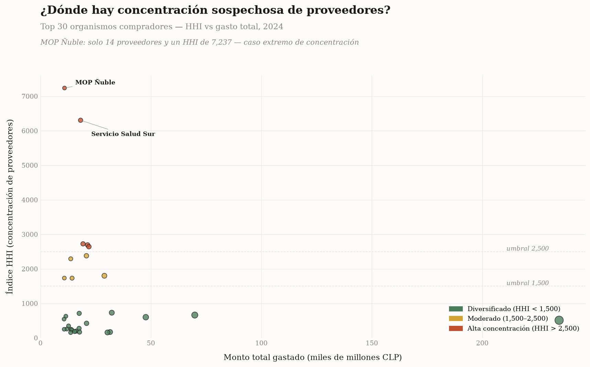

# ChileCompra — Análisis de Licitaciones Públicas

> Análisis de 918K órdenes de compra del Estado chileno en 2024 usando datos abiertos OCDS.
> Detección de concentración de mercado (HHI), top anómalos, estacionalidad y equidad territorial.

[](./LICENSE)
[](https://data.open-contracting.org/es/publication/144)
[](./sql/)

## Hallazgos principales

> **918,052 OC analizadas** | **5,321 organismos compradores** | **35,492 proveedores** | **$3.24 billones CLP**

### ¿Quién compra más al Estado?



### ¿Quién vende más al Estado?



### ¿Dónde están los proveedores?



### ¿Dónde hay concentración sospechosa de proveedores?



### Top 5 organismos con mayor concentración (HHI)

| Organismo | HHI | Proveedores | Nivel |
|---|---|---|---|
| MOP Ñuble (OO.HH.) | **7,237** | 14 | 🚨 Extremo |
| Servicio de Salud Sur | **6,304** | 280 | 🚨 Extremo |
| Parque Metropolitano | **2,724** | 164 | 🚨 Alto |
| Municipalidad Huechuraba | **2,692** | 447 | 🚨 Alto |
| PDI | **2,642** | 153 | 🚨 Alto |

**Interpretación:** HHI > 2,500 = mercado altamente concentrado. El MOP Ñuble con solo 14 proveedores y un HHI de 7,237 es caso de libro: uno o dos proveedores dominan casi todo el gasto.

---

**Stack final:** Pipeline Python (ETL + análisis) → Supabase Postgres (cuando se conecta) → Next.js 15 dashboard

## 🌐 Dashboard live

**🔗 https://chilecompra-anomalias.vercel.app**

4 páginas interactivas server-rendered con Recharts:
- `/` — Landing con KPIs
- `/compradores` — Top 15 organismos compradores
- `/proveedores` — Top 15 proveedores del Estado
- `/geografia` — Distribución por región
- `/concentracion` — Scatter HHI vs gasto

**Stack del dashboard:** Next.js 15 (App Router, RSC) + React 19 + Tailwind 3 + Recharts + Supabase SSR.

**Modo dual:**
- Con `NEXT_PUBLIC_SUPABASE_URL` configurado → datos live desde Postgres
- Sin env vars → fallback a CSVs locales (modo demo, default para preview deploys)

El SQL de migraciones está en `dashboard/supabase/migrations.sql` (5 funciones RPC + RLS + grants).

---

## Contexto

El Estado chileno gasta ~US$15 mil millones al año en compras públicas a través de la plataforma **Mercado Público**, administrada por [ChileCompra](https://www.chilecompra.cl). La Ley 19.886 obliga a 850 instituciones del Estado (ministerios, municipalidades, hospitales, fuerzas armadas, universidades) a comprar a través de esta plataforma.

Este proyecto analiza los datos abiertos oficiales en formato **OCDS** (Open Contracting Data Standard), publicados por [Open Contracting Partnership](https://data.open-contracting.org/es/publication/144).

## Preguntas de negocio que responde

1. **¿Hay concentración sospechosa de proveedores?** Calculamos el **HHI** (Herfindahl-Hirschman Index) por organismo público.
2. **¿Hay OC con precios anómalos?** Detección via z-score e IQR por categoría.
3. **¿Cuándo compra más el Estado?** Estacionalidad mensual y por día de la semana.
4. **¿Quiénes son los proveedores dominantes?** Top proveedores por monto y por diversidad de compradores.
5. **¿Hay equidad territorial?** Gasto por región del proveedor.

## Dataset

| Campo | Valor |
|---|---|
| **Fuente** | [Open Contracting Partnership - ChileCompra](https://data.open-contracting.org/es/publication/144) |
| **Formato** | OCDS (Open Contracting Data Standard), CSV bulk |
| **Período** | 2024-01-01 → 2024-12-31 |
| **OC totales (post-limpieza)** | 918,052 |
| **Licencia** | [CC0 1.0 Universal (dominio público)](https://creativecommons.org/publicdomain/zero/1.0/) |

### Pipeline de datos

```
OCDS bulk CSV (5GB)
    ↓
download.py (Fastly CDN)
    ↓
etl.py (chunked, año por año, parties filtrado por chunks)
    ↓
chilecompra_combined.parquet (80MB, 918K filas, 18 columnas)
    ↓
load_sqlite.py → chilecompra.db (440MB, 5 índices)
    ↓
run_eda.py → 5 CSVs de resultados en reports/
```

## Estructura del repo

```
chilecompra-anomalias-sql/
├── README.md                       ← este archivo
├── LICENSE                         ← MIT
├── .gitignore
├── requirements.txt
│
├── data/
│   ├── README.md                   ← método de descarga + limpieza
│   ├── chilecompra_combined.parquet  ← 80MB, datos limpios
│   ├── chilecompra.db              ← 440MB, SQLite para queries
│   ├── sample_oc.csv               ← 1000 filas para recruiter
│   └── temp/                       ← parquets anuales (gitignored)
│
├── src/
│   ├── download.py                 ← descarga OCDS con curl
│   ├── etl.py                      ← une 4 CSVs → parquet (optimizado RAM)
│   ├── load_sqlite.py              ← parquet → SQLite con índices
│   ├── load_supabase.py            ← alternativa para PostgreSQL
│   ├── run_eda.py                  ← ejecuta 5 queries analíticas
│   ├── generate_sample.py          ← crea sample_oc.csv
│   └── config.py                   ← paths + .env
│
├── sql/
│   ├── schema.sql                  ← DDL PostgreSQL
│   ├── 01_eda_exploracion.sql
│   ├── 02_concentracion_proveedores.sql  ← HHI
│   ├── 03_anomalias_precio.sql
│   ├── 04_estacionalidad.sql
│   └── queries_auxiliares.sql      ← vistas + funciones
│
├── src/
│   ├── download.py                 ← descarga OCDS con curl
│   ├── etl.py                      ← une 4 CSVs → parquet (optimizado RAM)
│   ├── load_sqlite.py              ← parquet → SQLite con índices
│   ├── load_supabase.py            ← alternativa para PostgreSQL
│   ├── run_eda.py                  ← ejecuta 5 queries analíticas
│   ├── generate_sample.py          ← crea sample_oc.csv
│   ├── generate_visualizations.py  ← genera 4 PNGs editoriales
│   └── config.py                   ← paths + .env
│
├── dashboard/                          ← Next.js 15 + React 19 + Recharts + Supabase
│   ├── app/                            ← App Router (Server Components)
│   ├── lib/                            ← queries, utils, Supabase clients, fallback
│   ├── supabase/migrations.sql         ← DDL + 5 funciones RPC + RLS
│   ├── package.json
│   └── .vercelignore                   ← excluye data/ del upload a Vercel
│
├── reports/
│   ├── 01_resumen_general.csv
│   ├── 02_top_compradores.csv
│   ├── 03_top_proveedores.csv
│   ├── 04_gasto_por_region.csv
│   ├── 05_hhi_top30.csv                ← hallazgos de concentración
│   └── images/                         ← 4 visualizaciones PNG editoriales
│
└── docs/
    ├── METODOLOGIA.md
    └── LIMITACIONES.md
```

## Cómo correr localmente

```bash
# 1. Clonar
git clone https://github.com/berriosb/chilecompra-anomalias-sql
cd chilecompra-anomalias-sql

# 2. Setup Python
python -m venv .venv
source .venv/bin/activate
pip install -r requirements.txt

# 3. Descargar datos OCDS (~525MB por año)
python src/download.py --years 2024 2025 --extract

# 4. ETL: unir CSVs en parquet limpio
python src/etl.py --years 2024 2025

# 5. Cargar a SQLite
python src/load_sqlite.py

# 6. Correr análisis
python src/run_eda.py

# 7. Ver resultados
ls reports/*.csv
sqlite3 data/chilecompra.db "SELECT * FROM ordenes_compra LIMIT 5"
```

## Stack técnico

| Capa | Tecnología | Razón |
|---|---|---|
| Datos | OCDS (CC0 1.0) | Datos abiertos oficiales sin auth |
| ETL | Python + pandas + pyarrow | Chunked processing, baja RAM |
| Storage | Parquet + SQLite | Eficiente, versionable, sin servicios externos |
| Queries | SQL estándar (CTEs, window functions) | Demuestra SQL avanzado |
| Visualización | Generada desde CSVs | Plotly/Matplotlib en próxima iteración |

## Limitaciones conocidas

Ver [`docs/LIMITACIONES.md`](./docs/LIMITACIONES.md) para detalle completo.

- **Período:** Solo 2024 (los datos OCDS históricos completos para Chile arrancan en 2022 pero los datasets por año tienen inconsistencias)
- **OC con monto $0 o negativo:** Filtradas (1.7% del dataset original)
- **OC con monto > $10B:** Filtradas (outliers extremos del source)
- **Compra Ágil (<$30K):** Excluida del dataset OCDS oficial
- **Empresas públicas:** No obligadas a usar Mercado Público, no aparecen
- **Obras públicas:** Excluidas (MOP, MINVU tienen mecanismo propio)

## Próximos pasos

- [ ] Generar visualizaciones (PNG + dashboard Next.js)
- [ ] Análisis de anomalías de precio con z-score por categoría UNSPSC
- [ ] Deploy dashboard en Vercel
- [ ] Cross-reference con SERNAC (proveedores con reclamos)
- [ ] Análisis de colusión por clusters temporales

## Licencia

- **Código:** MIT
- **Datos:** CC0 1.0 Universal — [Open Contracting Partnership](https://data.open-contracting.org/es/publication/144)
